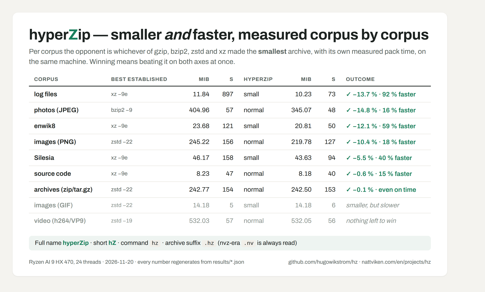
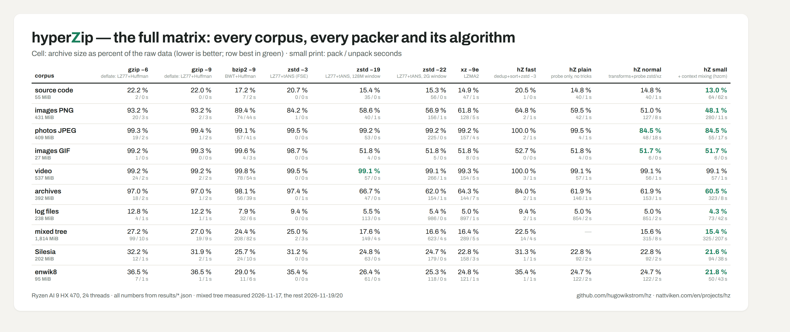
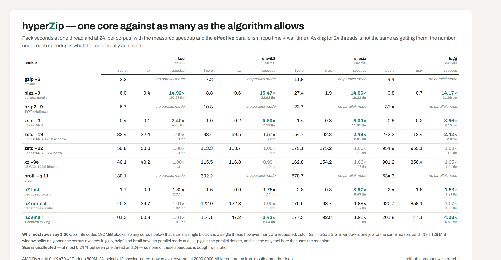

# hyperZip — an archiver that knows what it is packing

> **hyperZip** — command `hz`, hZ for short — was published as **nvz**
> until 2026-11-19. Only the name changed: every hZ reads every nvz
> archive bit for bit, and the Swedish command aliases remain. The codec
> tools were born nvcm/nvjpg/nvgpu and were renamed hzcm/hzjpg/hzgpu on
> 2026-11-20; stream formats and register strings are unchanged.


`tar | zstd` is two programs that know nothing about each other. tar emits
files in whatever order the directory tree happens to hold them; the
compressor sees the stream through a window and is never told that file
4000 is a copy of file 12, or that the nine megabytes of "noise" it just
gave up on are really a PNG stream that can be unfolded.

hZ knows. It classifies the content, stores duplicates once, sorts similar
files next to each other, unfolds PNG deflate layers and finds the recipe
that stitches them back bit-exactly, recodes JPEG Huffman layers to
arithmetic coding without touching a pixel — and lets every block choose
its codec by probing instead of assuming. Everything is lossless and proven
at pack time: whatever cannot be reproduced exactly is stored raw.



*Per corpus the opponent is whichever of gzip, bzip2, zstd and xz made the smallest archive, timed on the same machine; winning means beating it on both axes at once.*

Measured against the **best established tool per corpus** (whichever of
gzip, bzip2, zstd and xz produced the smallest archive, with its own pack
time on the same machine), hZ is **both smaller and faster on seven of nine
corpora** — source code −0.57 % and 15 % faster than `xz -9e`, PNG −10.4 %
and 18 % faster than `zstd -22`, logs −15.4 % and 79 % faster than
`xz -9e` — and never meaningfully larger on the other three. The full
evaluation, with every number regenerable from `results/*.json`:

* **[report/broad-evaluation.md](report/broad-evaluation.md)** — the full
  report
* **<https://nattviken.com/projekt/hz/>** — project page with FAQ
  (Swedish; English at [/en/projects/hz/](https://nattviken.com/en/projects/hz/))


```bash
make                       # builds hz, hzcm, hzjpg (needs libzstd-dev,
                           # liblzma-dev, zlib1g-dev; g++ with C++17)
./src/hz mytree           # -> mytree.hz, ONE archive of the whole tree
./src/hz -d mytree.hz     # the tree back, bit for bit
./src/hz -t mytree.hz     # verify: every file against its hash
```

---

The archive suffix is `.hz` (the nvz-era `.nv` is always read). In
running text the tool is written **hZ**; the command is `hz`.

## The command line is gzip's

The surface is gzip's because gzip's surface is the one your fingers
already know. Same flags, same default behavior: a packed file is replaced
by `file.hz`.

```
hz file                # -> file.hz, original gone
hz -d file.hz          # -> file, archive gone
hz -c file > out.nv    # to standard out, file untouched
hz -k -9 file          # keep the file, pack as small as possible
hz -l ark.nv           # packed, unpacked, ratio
hz -t ark.nv           # unpack and compare against the register
cat file | hz | ...    # no file name: standard in -> standard out
```

`-c -d -f -k -l -q -r -S -t -v -V` and `-1`…`-9` mean what they mean in
gzip. `-1`–`-3` select mode **fast**, `-4`–`-6` **normal**, `-7`–`-9`
**small**. Exit status is gzip's: 0 success, 1 error, 2 warning.

hZ's own flags: `-j/--jobs=N`, `--mode=`, `--codec=`, `--no-dedup`,
`--no-transform`, `--block-cap=MiB`, `--portable`, and the ablation flags
`--no-sort` and `--no-classing`.

**One deliberate deviation.** gzip says `is a directory -- ignored` for a
directory. A directory is exactly what hZ is for, so a directory operand
is packed into **one** archive of the whole tree — with deduplication and
sorting between the files, which is most of the win. The source tree is
**always** left in place; `-r` instead does gzip's literal thing, one file
at a time.

**The subcommands** do the same work with explicit targets:

```
hz pack   <dir> <archive.hz> [--mode fast|normal|small] [--codec ...] [-j N]
hz unpack <archive.hz> <target>
hz list   <archive.hz>
hz test   <dir>            # pack, unpack, compare bit for bit
```

**Swedish aliases are permanent.** The tool was born Swedish and the
published reports and measurement scripts use the old names, so they all
keep working: `packa`, `packa-upp`, `lista`, `prova`, `--läge`, `--kodek`,
`--blocktak`, `--jobb`, `--utan-dedup`, `--utan-omvandling`,
`--utan-sortering`, `--utan-klassning`, and the mode values
`snabb`/`liten`.

---

## The five things tar does not do

### 1. Identical files are stored once

Content is hashed with blake2b; duplicates become pointers into the same
block. tar stores every copy and hopes the compressor finds them, which it
only does if they happen to sit within the window. In the PNG corpus
28.7 % of the bytes are duplicates — in the code corpus 0.7 %, where
deduplication accordingly does nothing. Both numbers are in the tables:
the row **hz, tricks off** is the same packer with deduplication and
transforms disabled.

### 2. Similar files are placed next to each other

Entries are sorted by class and extension before compression, so all the
JavaScript sits in one run and all the screenshots in another.

**But measure it before you believe it.** When this was finally measured
in isolation (report §7.1, flag `--no-sort`), the sort was worth **zero**
on both the code and the PNG corpus — with a small window even slightly
negative. The reasons: the PNG corpus has a single file type, so the sort
reproduces directory order; the code corpus fits entirely inside
`xz -9e`'s dictionary; and a real project tree already keeps similar
files together, directory by directory. The sort pays only when
similarity is **scattered** and the window **small**: the same
5 974 code files thrown into 200 random
directories give −8.0 % through a 2 MiB window and −2.2 % through a 64 MiB
dictionary (`experiment/sorting.sh`). This is also exactly what the
prior art says (gwern.net/sort): the method is old, and its value is a
function of the window. hZ's measured wins come from items 3, 4 and hzcm
— not from this one.

One sorting rule did survive measurement: within a group, files larger
than an eighth of the block cap go first — the large file builds the
dictionary the smaller, similar files then match into. Worth 2.0 % on
corpora with multi-volume scans (zlib-ng's `neuro`), neutral elsewhere.

### 3. PNGs are unfolded and recompressed

A PNG is already deflate-compressed, and 1996-vintage deflate is a poor
wrapper for image data: a 32 kB window, one file at a time. hZ unfolds
the IDAT stream to raw filter rows and compresses them together with every
other image's raw data.

The way back is the hard part. Deflate is not canonical — the same input
gives different output depending on level, memory level, strategy **and
implementation** — so hZ finds the **recipe**: the zlib parameter set that
reproduces exactly the stream the file already has, and stores it together
with a behavioral fingerprint of the deflate engine. On unpack every IDAT
chunk is verified against its CRC; on an engine mismatch the parameter
space is searched, and if nothing reproduces the stream hZ refuses with
both engines named — never wrong data. (This portability hole, and two
more, came out of an external code review; see *The three flaws* below.)

Unfolding pays even for images deflate already squeezed 50:1 — the win
lies in the similarity **between** images, not within them: −42.9 % on a
corpus of 4 618 real PNGs.

### 4. JPEGs are recoded without touching a pixel

A JPEG is DCT coefficients entropy-coded with Huffman, and Huffman cannot
put a symbol in less than one whole bit. hzjpg decodes the stream and
recodes the *same* coefficients with an adaptive binary arithmetic coder
whose contexts are the neighbouring blocks and slots: −15.1 % on 1 143
real photos, bit-exact, proven per file by re-encoding to Huffman and
comparing before the transform is accepted. Not a new idea — packJPG
(2006) and Lepton (2016) publish −20 to −22 % — but hZ's is 762 lines of
C you can read in an afternoon.

### 5. Nothing is assumed — everything is probed

"Already compressed" is not a property of a file extension. Every block
chooses its codec by compressing a sample with every candidate, with three
outcomes (raw / cheap / strong) rather than two — because half a percent
of 2.9 GB of film is fourteen megabytes, and a cheap codec takes them for
free. Opaque-but-compressible blocks get a two-step rule on the whole
block, since a sample cannot tell film from archives-of-archives (report
§4.2).

---

## Prior work: where the five things come from

None of the five is new. That belongs here, not just in a comment thread,
because the question "isn't this all known technique?" has an honest
answer: yes.

| part | known since | hZ vs the prior art |
|:--|:--|:--|
| similarity sorting | *Sort Before Compression* (<https://gwern.net/sort>), solid archives in RAR/7-Zip, lrzip | same idea; its contribution measured separately with `--no-sort` |
| dedup | borg, restic, ZFS; chunking since LBFS (2001) | weaker — whole files, not chunks |
| deflate back to raw + recipe | precomp, preflate, reflate | narrower — only streams zlib itself wrote |
| lossless JPEG recoding | packJPG, Lepton (Dropbox 2016), brunsli → JPEG XL | **worse** — hZ −15.1 %, published −20 to −22 % |
| context mixing (hzcm) | PAQ (Matt Mahoney), lpaq, zpaq, cmix | smaller model — paq8px beats hzcm on enwik8, 15.8 vs 20.4 MB |
| content-aware filter choice | FreeArc, zpaq method strings | same thought; hZ probes the data instead of trusting the extension |

What is original is the packaging — the parts in one format with one
reconstruction guarantee, codec choice settled by probing — and the
measurement of what the packaging is worth. Full treatment with numbers:
report §7.

---

## hzcm: an in-house compressor for text and source code

Dictionary compressors pay bits for a reference even when the next
character was completely predictable. hzcm predicts the next **bit** with
eight models voting at once — byte contexts of order 0–8, a word model, a
match model — weighted by a mixer that learns which model to trust in this
kind of data. It beats `xz -9e` on both standard corpora: 1.677 bits/byte
on Silesia and 1.713 on enwik8, between the dictionary compressors and the
heavyweight context mixers on the LTCB scale, in a 30 kB binary with no
built-in dictionaries at all. Its price is ~1 MB/s, which is why only mode
`small` uses it, and only on blocks where it wins the probe.

---

## The modes

| mode | what happens | when |
|:--|:--|:--|
| `fast` | zstd −3, no transforms | matches a plain `tar \| zstd -3` script (`-1`) |
| `normal` | transforms on; zstd −19 or covering-dictionary xz by probe; opaque blocks settled by the two-step rule | `-4` .. `-6` |
| `small` | plus hzcm where it wins (in parallel 32 MiB shards, `hzcm-p`, on blocks of 64 MiB and up), LZMA with a covering dictionary as an extra candidate on opaque blocks, and a whole-block re-check when the probe's lead was thin | **default** |
| `gpu` | plus hzlz (GPU LZ77) in the probe | never — see the GPU section |

The difference between `normal` and `small` is time, not just codec
choice: `small` pays for entire extra compressions to settle questions
the sample cannot answer. That is why `normal` is the mode that wins on
**time** against the established tools, and `small` the one that wins on
**size**.

---

## Results

The row `tar.zst -3 (the baseline)` is the pipeline hZ replaces. The
tables are regenerated with `python3 benchmark/report.py --into-readme`;
never edit them by hand.



*All nine corpora against every packer; every number regenerates from `results/*.json`.*

<!-- TABELLER -->

### Source code — 55.4 MiB in 5 974 files

| packer | size MiB | ratio | vs baseline | pack | unpack | exact |
|:--|--:|--:|--:|--:|--:|:-:|
| tar (uncompressed) | 60.83 | 0.91× | +430.8 % | **0 s** | 0 s | yes |
| tar.gz -6 | 12.32 | 4.50× | +7.5 % | 2 s | 0 s | yes |
| tar.gz -9 (pigz) | 12.18 | 4.55× | +6.3 % | 0 s | 0 s | yes |
| tar.bz2 -9 | 9.51 | 5.82× | −17.0 % | 7 s | 2 s | yes |
| tar.zst -3 (the baseline) | 11.46 | 4.83× | +0.0 % | 0 s | 0 s | yes |
| tar.zst -19 --long | 8.53 | 6.49× | −25.6 % | 35 s | 0 s | yes |
| tar.zst -22 --ultra | 8.45 | 6.55× | −26.2 % | 56 s | 0 s | yes |
| tar.xz -9e | 8.23 | 6.73× | −28.2 % | 47 s | 1 s | yes |
| **hz fast** | 11.34 | 4.88× | −1.0 % | 1 s | 0 s | yes |
| **hz, tricks off** | 8.18 | 6.77× | −28.6 % | 40 s | 1 s | yes |
| **hz normal** | 8.18 | 6.77× | −28.6 % | 40 s | 1 s | yes |
| **hz small** | **7.20** | 7.69× | −37.1 % | 64 s | 62 s | yes |

### Images (PNG) — 431.1 MiB in 4 618 files

| packer | size MiB | ratio | vs baseline | pack | unpack | exact |
|:--|--:|--:|--:|--:|--:|:-:|
| tar (uncompressed) | 438.41 | 0.98× | +20.8 % | 3 s | 0 s | yes |
| tar.gz -6 | 401.67 | 1.07× | +10.7 % | 20 s | 3 s | yes |
| tar.gz -9 (pigz) | 401.89 | 1.07× | +10.8 % | 2 s | 3 s | yes |
| tar.bz2 -9 | 385.38 | 1.12× | +6.2 % | 74 s | 44 s | yes |
| tar.zst -3 (the baseline) | 362.85 | 1.19× | +0.0 % | **1 s** | 0 s | yes |
| tar.zst -19 --long | 252.73 | 1.71× | −30.3 % | 40 s | 1 s | yes |
| tar.zst -22 --ultra | 245.22 | 1.76× | −32.4 % | 156 s | 1 s | yes |
| tar.xz -9e | 266.41 | 1.62× | −26.6 % | 128 s | 5 s | yes |
| **hz fast** | 279.29 | 1.54× | −23.0 % | 2 s | 1 s | yes |
| **hz, tricks off** | 256.46 | 1.68× | −29.3 % | 42 s | 1 s | yes |
| **hz normal** | 219.78 | 1.96× | −39.4 % | 127 s | 8 s | yes |
| **hz small** | **207.24** | 2.08× | −42.9 % | 280 s | 11 s | yes |

### Photos (JPEG) — 408.5 MiB in 1 143 files

| packer | size MiB | ratio | vs baseline | pack | unpack | exact |
|:--|--:|--:|--:|--:|--:|:-:|
| tar (uncompressed) | 409.37 | 1.00× | +0.8 % | 2 s | 0 s | yes |
| tar.gz -6 | 405.81 | 1.01× | −0.1 % | 19 s | 2 s | yes |
| tar.gz -9 (pigz) | 406.04 | 1.01× | −0.1 % | 1 s | 2 s | yes |
| tar.bz2 -9 | 404.94 | 1.01× | −0.3 % | 57 s | 41 s | yes |
| tar.zst -3 (the baseline) | 406.30 | 1.01× | +0.0 % | **0 s** | 0 s | yes |
| tar.zst -19 --long | 405.09 | 1.01× | −0.3 % | 53 s | 0 s | yes |
| tar.zst -22 --ultra | 405.09 | 1.01× | −0.3 % | 225 s | 0 s | yes |
| tar.xz -9e | 405.43 | 1.01× | −0.2 % | 157 s | 4 s | yes |
| **hz fast** | 408.50 | 1.00× | +0.5 % | 2 s | 1 s | yes |
| **hz, tricks off** | 406.43 | 1.01× | +0.0 % | 4 s | 1 s | yes |
| **hz normal** | **345.07** | 1.18× | −15.1 % | 48 s | 18 s | yes |
| **hz small** | **345.07** | 1.18× | −15.1 % | 55 s | 17 s | yes |

### Images (GIF) — 27.4 MiB in 105 files

| packer | size MiB | ratio | vs baseline | pack | unpack | exact |
|:--|--:|--:|--:|--:|--:|:-:|
| tar (uncompressed) | 27.62 | 0.99× | +2.1 % | 0 s | 0 s | yes |
| tar.gz -6 | 27.18 | 1.01× | +0.5 % | 1 s | 0 s | yes |
| tar.gz -9 (pigz) | 27.19 | 1.01× | +0.6 % | 0 s | 0 s | yes |
| tar.bz2 -9 | 27.28 | 1.00× | +0.9 % | 4 s | 3 s | yes |
| tar.zst -3 (the baseline) | 27.04 | 1.01× | +0.0 % | **0 s** | 0 s | yes |
| tar.zst -19 --long | 14.18 | 1.93× | −47.6 % | 4 s | 0 s | yes |
| tar.zst -22 --ultra | 14.18 | 1.93× | −47.6 % | 5 s | 0 s | yes |
| tar.xz -9e | 14.19 | 1.93× | −47.5 % | 8 s | 0 s | yes |
| **hz fast** | 14.44 | 1.90× | −46.6 % | 0 s | 0 s | yes |
| **hz, tricks off** | 14.18 | 1.93× | −47.6 % | 4 s | 0 s | yes |
| **hz normal** | **14.18** | 1.93× | −47.6 % | 6 s | 0 s | yes |
| **hz small** | **14.18** | 1.93× | −47.6 % | 6 s | 0 s | yes |

### Film (h264/VP9) — 536.7 MiB in 67 files

| packer | size MiB | ratio | vs baseline | pack | unpack | exact |
|:--|--:|--:|--:|--:|--:|:-:|
| tar (uncompressed) | 536.82 | 1.00× | +0.6 % | 1 s | 0 s | yes |
| tar.gz -6 | 532.39 | 1.01× | −0.3 % | 24 s | 2 s | yes |
| tar.gz -9 (pigz) | 532.54 | 1.01× | −0.2 % | 2 s | 2 s | yes |
| tar.bz2 -9 | 535.53 | 1.00× | +0.3 % | 78 s | 54 s | yes |
| tar.zst -3 (the baseline) | 533.86 | 1.01× | +0.0 % | **0 s** | 0 s | yes |
| tar.zst -19 --long | **532.02** | 1.01× | −0.3 % | 57 s | 0 s | yes |
| tar.zst -22 --ultra | 532.03 | 1.01× | −0.3 % | 266 s | 1 s | yes |
| tar.xz -9e | 532.86 | 1.01× | −0.2 % | 154 s | 5 s | yes |
| **hz fast** | 536.75 | 1.00× | +0.5 % | 3 s | 1 s | yes |
| **hz, tricks off** | 532.04 | 1.01× | −0.3 % | 57 s | 1 s | yes |
| **hz normal** | 532.04 | 1.01× | −0.3 % | 56 s | 1 s | yes |
| **hz small** | 532.04 | 1.01× | −0.3 % | 57 s | 1 s | yes |

### Archives (zip/tar.gz) — 391.8 MiB in 133 files

| packer | size MiB | ratio | vs baseline | pack | unpack | exact |
|:--|--:|--:|--:|--:|--:|:-:|
| tar (uncompressed) | 391.93 | 1.00× | +2.7 % | 1 s | 0 s | yes |
| tar.gz -6 | 380.05 | 1.03× | −0.5 % | 18 s | 2 s | yes |
| tar.gz -9 (pigz) | 380.14 | 1.03× | −0.4 % | 1 s | 2 s | yes |
| tar.bz2 -9 | 384.49 | 1.02× | +0.7 % | 56 s | 39 s | yes |
| tar.zst -3 (the baseline) | 381.78 | 1.03× | +0.0 % | **0 s** | 1 s | yes |
| tar.zst -19 --long | 261.37 | 1.50× | −31.5 % | 47 s | 0 s | yes |
| tar.zst -22 --ultra | 242.77 | 1.61× | −36.4 % | 154 s | 1 s | yes |
| tar.xz -9e | 251.75 | 1.56× | −34.1 % | 144 s | 7 s | yes |
| **hz fast** | 329.03 | 1.19× | −13.8 % | 2 s | 1 s | yes |
| **hz, tricks off** | 242.51 | 1.62× | −36.5 % | 146 s | 1 s | yes |
| **hz normal** | 242.51 | 1.62× | −36.5 % | 153 s | 1 s | yes |
| **hz small** | **237.00** | 1.65× | −37.9 % | 323 s | 8 s | yes |

### Log files — 238.3 MiB in 76 files

| packer | size MiB | ratio | vs baseline | pack | unpack | exact |
|:--|--:|--:|--:|--:|--:|:-:|
| tar (uncompressed) | 238.39 | 1.00× | +965.0 % | 0 s | 0 s | yes |
| tar.gz -6 | 30.46 | 7.82× | +36.1 % | 4 s | 1 s | yes |
| tar.gz -9 (pigz) | 29.03 | 8.21× | +29.7 % | 1 s | 1 s | yes |
| tar.bz2 -9 | 18.92 | 12.60× | −15.5 % | 32 s | 6 s | yes |
| tar.zst -3 (the baseline) | 22.38 | 10.65× | +0.0 % | **0 s** | 0 s | yes |
| tar.zst -19 --long | 13.09 | 18.21× | −41.5 % | 113 s | 0 s | yes |
| tar.zst -22 --ultra | 12.92 | 18.45× | −42.3 % | 986 s | 0 s | yes |
| tar.xz -9e | 11.84 | 20.12× | −47.1 % | 897 s | 1 s | yes |
| **hz fast** | 22.41 | 10.63× | +0.1 % | 2 s | 1 s | yes |
| **hz, tricks off** | 11.87 | 20.08× | −47.0 % | 854 s | 2 s | yes |
| **hz normal** | 11.87 | 20.08× | −47.0 % | 851 s | 2 s | yes |
| **hz small** | **10.23** | 23.30× | −54.3 % | 73 s | 42 s | yes |

### Mixed project tree (symbios-3d) — 1 814.4 MiB in 15 139 files

| packer | size MiB | ratio | vs baseline | pack | unpack | exact |
|:--|--:|--:|--:|--:|--:|:-:|
| tar (uncompressed) | 1,804.14 | 1.01× | +298.4 % | 7 s | 2 s | yes |
| tar.gz -6 | 494.04 | 3.67× | +9.1 % | 99 s | 10 s | yes |
| tar.gz -9 (pigz) | 489.62 | 3.71× | +8.1 % | 19 s | 9 s | yes |
| tar.bz2 -9 | 442.88 | 4.10× | −2.2 % | 208 s | 82 s | yes |
| tar.zst -3 (the baseline) | 452.83 | 4.01× | +0.0 % | **2 s** | 3 s | yes |
| tar.zst -19 --long | 319.30 | 5.68× | −29.5 % | 149 s | 4 s | yes |
| tar.zst -22 --ultra | 301.21 | 6.02× | −33.5 % | 623 s | 4 s | yes |
| tar.xz -9e | 297.54 | 6.10× | −34.3 % | 289 s | 5 s | yes |
| **hz fast** | 407.37 | 4.45× | −10.0 % | 14 s | 4 s | yes |
| **hz normal** | 282.25 | 6.43× | −37.7 % | 315 s | 8 s | yes |
| **hz small** | **279.10** | 6.50× | −38.4 % | 325 s | 207 s | yes |

### Silesia (standard corpus) — 202.1 MiB in 12 files

| packer | size MiB | ratio | vs baseline | pack | unpack | exact |
|:--|--:|--:|--:|--:|--:|:-:|
| tar (uncompressed) | 202.14 | 1.00× | +220.1 % | **0 s** | 0 s | yes |
| tar.gz -6 | 65.06 | 3.11× | +3.0 % | 12 s | 1 s | yes |
| tar.gz -9 (pigz) | 64.52 | 3.13× | +2.2 % | 2 s | 1 s | yes |
| tar.bz2 -9 | 52.04 | 3.88× | −17.6 % | 24 s | 10 s | yes |
| tar.zst -3 (the baseline) | 63.15 | 3.20× | +0.0 % | 0 s | 0 s | yes |
| tar.zst -19 --long | 50.17 | 4.03× | −20.6 % | 63 s | 0 s | yes |
| tar.zst -22 --ultra | 49.82 | 4.06× | −21.1 % | 179 s | 0 s | yes |
| tar.xz -9e | 46.17 | 4.38× | −26.9 % | 158 s | 3 s | yes |
| **hz fast** | 63.17 | 3.20× | +0.0 % | 1 s | 1 s | yes |
| **hz, tricks off** | 46.14 | 4.38× | −26.9 % | 92 s | 2 s | yes |
| **hz normal** | 46.14 | 4.38× | −26.9 % | 92 s | 2 s | yes |
| **hz small** | **43.62** | 4.63× | −30.9 % | 94 s | 38 s | yes |

### enwik8 (standard corpus) — 95.4 MiB in 1 files

| packer | size MiB | ratio | vs baseline | pack | unpack | exact |
|:--|--:|--:|--:|--:|--:|:-:|
| tar (uncompressed) | 95.37 | 1.00× | +182.1 % | **0 s** | 0 s | yes |
| tar.gz -6 | 34.83 | 2.74× | +3.0 % | 7 s | 1 s | yes |
| tar.gz -9 (pigz) | 34.80 | 2.74× | +2.9 % | 1 s | 1 s | yes |
| tar.bz2 -9 | 27.66 | 3.45× | −18.2 % | 11 s | 6 s | yes |
| tar.zst -3 (the baseline) | 33.80 | 2.82× | +0.0 % | 0 s | 0 s | yes |
| tar.zst -19 --long | 25.18 | 3.79× | −25.5 % | 61 s | 0 s | yes |
| tar.zst -22 --ultra | 24.11 | 3.96× | −28.7 % | 118 s | 0 s | yes |
| tar.xz -9e | 23.68 | 4.03× | −29.9 % | 121 s | 1 s | yes |
| **hz fast** | 33.80 | 2.82× | +0.0 % | 1 s | 1 s | yes |
| **hz, tricks off** | 23.59 | 4.04× | −30.2 % | 122 s | 2 s | yes |
| **hz normal** | 23.59 | 4.04× | −30.2 % | 122 s | 2 s | yes |
| **hz small** | **20.81** | 4.58× | −38.4 % | 50 s | 43 s | yes |

<!-- SLUT TABELLER -->

### Smaller AND faster: seven of nine corpora

Harder than either column alone: does hZ beat the **same** opponent on
both axes at once? (`python3 experiment/dominance.py`)

```
corpus     best established                 bytes    sec | hz               bytes    sec | outcome
kod        tar.xz -9e                   8 629 516     47 | normal       8 580 323     40 | DOMINATES (-0.57 % size, -15 % time)
png        tar.zst -22 --ultra        257 132 369    156 | normal     230 452 176    127 | DOMINATES (-10.38 % size, -18 % time)
foto       tar.bz2 -9                 424 611 032     57 | normal     361 834 581     48 | DOMINATES (-14.78 % size, -16 % time)
gif        tar.zst -22 --ultra         14 867 185      5 | liten       14 864 575      6 | smaller, but slower (-0.02 % size, +20 % time)
film       tar.zst -19 --long         557 861 782     57 | normal     557 880 433     56 | faster, but larger (+0.00 % size, -0 % time)
arkiv      tar.zst -22 --ultra        254 567 277    154 | normal     254 287 214    153 | DOMINATES (-0.11 % size, -1 % time)
logg       tar.xz -9e                  12 419 456    897 | liten       10 724 600     73 | DOMINATES (-13.65 % size, -92 % time)
silesia    tar.xz -9e                  48 408 228    158 | liten       45 741 795     94 | DOMINATES (-5.51 % size, -40 % time)
enwik8     tar.xz -9e                  24 831 492    121 | liten       21 821 216     50 | DOMINATES (-12.12 % size, -59 % time)

dominates on 7 of 9 corpora
```

The two that do not dominate are the two with nothing to win: gif and
film are already entropy-coded (0.02 % and 0.00 % available). enwik8 used
to sit with them — a single 95 MB file fills one block, so nothing could
be parallelized — until hzcm-p split the block into independent shards:
pack 129 to 50 s, unpack 132 to 43 s, and the corpus flipped to
dominated. The boundary runs not between data types but between
exploitable structure and none.

### And then reality

On the live archive this project was started for — 2.9 GB that is mostly
TikTok film — the total win is −0.09 %. Film is already compressed, and no
archiver changes that. The code and images inside it (25 of 2 900 MB) do
gain −3.8 %. Know what your data is before you swap your pipeline.

---

## How fast can it get? The floor is not the codec

`hz fast` already beats zip soundly — 29.5 % smaller and 3× faster than
`zip -6` on the code corpus — but making it faster *by compressing worse*
buys nothing: with compression disabled entirely (`--codec ra`) the mode
takes 660 of its 740 ms. The codec is eleven percent of the time; the rest
is five sweeps over the data (read, hash, read again, copy into the block,
write), and thread scaling flattens at 1.9× on 24 threads because the work
is memory-bound. A genuinely faster mode means fewer sweeps — hash during
the pack read, stream blocks through the codec — not a weaker codec.
Details and measurements: report §8 and `results/speed-floor.json`.

### One core, and all of them



*Pack time at one thread and at twenty-four, measured per corpus
(`python3 benchmark/threads.py <corpus>`).*

Measuring both ends turned up something that reframes every time column
above: **at these settings the heavy established packers cannot use a
second core.** `xz -9e` codes 192 MiB blocks, so a smaller corpus is one
block and one thread however many are requested — 1.00× on source code,
1.06× on Silesia. `zstd -22 --ultra` is the same story through its 2 GiB
window; `zstd -19` splits only once the corpus passes 128 MiB. gzip, bzip2
and brotli have no parallel mode at all, and `pigz` — the parallel deflate
— is the only tool here that uses the machine, at 14–15×.

hZ gains 1.5–3.6× in `fast` and up to 4.3× in `small`, the latter from the
hzcm-p shards. Archive size moves by at most 0.24 % between one thread and
twenty-four, so none of it is bought with ratio.

Two notes for anyone reproducing this. `-j` changes **the archive, not only
the time**: the job count sizes the xz dictionary budget and the hzcm-p
shard count, and the default is `min(24, cores)` for both packing and
unpacking. And the machine matters — these numbers are from an AMD Ryzen
AI 9 HX 470, 24 logical / 12 physical cores pinned at 2.0 GHz by the
powersave governor, 28 GiB RAM, NVMe. A boosting CPU would flatter the
single-thread column.

---

## The GPU mode: built, measured, and not worth it

The question was whether a GPU mode makes packing faster. The answer is
**no on this machine** — measured at four levels rather than argued
(`src/hzgpu.c` is a real Vulkan compute host with three kernels and its
own codec, `hzlz`):

1. **The ceiling.** The GPU is integrated and shares the memory bus:
   34 881 MiB/s for the GPU against 31 349 for 24 CPU threads — 1.11×.
   And the expensive lesson: a CPU reading the GPU's write-combined memory
   runs **67× slower**; buffers the CPU reads back must be HOST_CACHED.
2. **The kernels.** blake2b hashing: the GPU loses. LZ77 matching: the GPU
   wins 2.1–2.7×, with zero deviations over 16.8 million positions — the
   only broadly parallel part of a packer.
3. **The codec.** hzlz with the GPU matcher and with the CPU matcher take
   the same time: the parallel half is a quarter of the codec, and entropy
   coding is serial by construction. Amdahl wins. `zstd -6` gives a better
   ratio in an eighth of the time.
4. **The archive.** Mode `gpu` lets hzlz compete for every block; the
   probe — hZ's own mechanism for not assuming — rejects it by itself.

The code stays in the repo as a measurement instrument. Unpacking hzlz is
pure CPU: an archive must never be hostage to a graphics driver.

---

## Portable: macOS and Windows

The Linux binary is the optimized implementation. For everywhere else
there is **`portable/hzpy.py`** — pure standard-library Python (3.8+), no
build, no dependencies:

```bash
python3 portable/hzpy.py pack   mytree mytree.hz
python3 portable/hzpy.py unpack mytree.hz out/
python3 portable/hzpy.py list   mytree.hz
python3 portable/hzpy.py test   mytree.hz
```

It writes ordinary hZ v3 archives restricted to the codecs
{ra, xz9e, xz9e-j0} with no transforms — the Linux hZ unpacks them bit
for bit, and vice versa for archives made with **`hz pack --portable`**.
Other hZ archives are read as far as their codecs allow: xz and raw
blocks always, zstd blocks if the optional `zstandard` package is
installed, and hzcm/hzlz blocks or transformed objects are refused with a
message that says what to do — never with wrong data. It is deliberately
slow and slightly larger: that is the price of running everywhere, and the
measured trade is stated rather than hidden. Windows cannot always create
symlinks; those are skipped with a warning and exit status 2.

---

## How it is built

**One C++17 binary** (`src/cpp/`, ~430 kB): hzcm and hzjpg are linked in
and executed as worker processes via `/proc/self/exe`; zstd, xz and zlib
are called as in-process libraries. `small` (Swedish alias `liten`) is
the default mode.

```
src/cpp/main.cpp       command line and worker dispatch
src/cpp/cli.cpp        the gzip surface
src/cpp/archive.cpp    blocks, register (v1/v2/v3), pack/unpack
src/cpp/codec.cpp      zstd/xz/hzcm/hzlz + the probe
src/cpp/transform.cpp  PNG recipes and the JPEG worker calls
src/cpp/tree.cpp       classification and the tree walk
src/cpp/worker.cpp     fork/exec workers (the three traps are commented)
src/hzcm.c             the context mixer (also a standalone binary)
src/hzjpg.c            the JPEG recoder (also a standalone binary)
src/hzgpu.c            the Vulkan measurement instrument
portable/hzpy.py       the stdlib-Python portable implementation
src/hz.py             RETIRED Python implementation, kept verbatim as the
                       v1 format reference (deliberately untranslated)
```

**Language note.** The source, CLI, Makefile, man pages and the main test
and experiment entry points are English (translated 2026-11-19); Swedish
CLI names remain as permanent aliases. The older measurement scripts
(prova-allt.sh, benchmark/, aterskapning, protokoll, bygg-korpus and a few
one-off experiments) carry an English header and keep their Swedish inline
comments for now — they are verified by their own runs and are translated
as each is next touched, rather than wholesale, which would risk silent
drift in verified measurement code.
Three kinds of Swedish survive on purpose: **archive format strings**
(block classes like `binar`/`opak`/`jpeg-kropp`, codec names — millions of
archived bytes contain them), **top-level directory and corpus names**
(`corpus/kod`, `report/`, `tests/flaws.sh` … are referenced by published
reports, PDFs and links; renaming them would break every published
reproduction command), and the **retired `src/hz.py`**. The report lives
in `report/`.

**Three faults the port exposed** (general enough to be worth repeating):
a malloc
between fork and exec in a threaded process can deadlock forever; pipes
inherited across parallel workers suppress EOF; and a build rule that
tracks one header links object files that disagree about a struct's
layout. All three are documented at the place in the code where they
happened.

**The three flaws from the external review** (Ted Lyngmo, 2026-11-18):
PNG recipes were not portable across deflate engines — and hid a
silent-corruption path for streams of the right length but wrong bytes;
write
failures could cost data because no write was checked while the gzip
surface deletes originals; an unreadable file crashed the process with a
core dump. All three fixed, all three regression-tested in
`tests/flaws.sh`, all three documented in report §6. They shared a cause
worth stating: hZ's own self-check packs and unpacks on the same machine,
in a successful flow, with readable files and free disk — all three lived
outside that boundary.

---

## What does not work

* **Progressive JPEG** is stored raw (hzjpg covers baseline sequential).
* **PNG from unknown deflate engines** (zlib-ng, libdeflate, Chrome) is
  stored raw at pack time; at unpack time a foreign-engine archive is
  rescued by parameter search or refused — never corrupted.
* **rANS was tried and removed.** An order-0 interleaved rANS coder
  (Duda's ANS, Giesen's rans_byte construction) was implemented,
  measured and deleted the same day: 63.7 % vs zstd -3's 35.4 % on
  enwik8 — a pure entropy stage cannot beat match finding, and zstd's
  FSE is already ANS. The code lives in git history; the measurement is
  the answer.
* **hzcm is slow** (~1 MB/s per stream) and only mode `small` uses it.
  Blocks of 64 MiB and up are coded as `hzcm-p` — independent 32 MiB
  shards in parallel — which cut enwik8 from 129/132 s (pack/unpack) to
  49/43 s for +1.9 % size. `--codec hzcm` still forces the single-stream
  minimum. Shard curve measured in `src/cpp/codec.cpp`.
* **Memory scales with the whole tree** (~1.4× raw data), and the xz
  dictionary budget depends on free memory at start — measure on an
  unloaded machine. Report §8 holds the full ranked list of fourteen
  limitations, each with its measurement.
* **No encryption, no redundancy, no streaming stdin.**

---

## The test suite

```bash
make test                             # roundtrip on corpus/kod + every JPEG
bash tests/test-all.sh                # 44 edge cases: symlinks, åäö, newlines
                                      #   in names, 1985/2031 timestamps, modes
python3 tests/random-trees.py 400     # randomized trees, full roundtrip,
                                      #   failures print their seed
bash tests/flaws.sh                   # the three review flaws as regressions
bash experiment/kernel-test.sh        # the Linux kernel from kernel.org,
                                      #   md5 manifests before and after
bash experiment/corpora.sh            # zlib-ng/corpora: eight third-party
                                      #   corpora (part of every full test run)
bash experiment/ablation.sh kod xz9e  # one trick at a time
python3 experiment/dominance.py       # both axes against the best opponent
```

The suite found real faults at every stage — a directory symlink that
vanished silently, directory mtimes never restored, the struct-layout
build fault, the three review flaws. That is what it is for.

## Author

The idea and direction: **Hugo Wikström** — <hugo.wikstrom@gmail.com>,
also on Facebook. Every design decision in hZ is measured rather than
guessed; the per-technique prior art is named in
[report/broad-evaluation.md](report/broad-evaluation.md).

## License

GPL-2.0-only — the kernel's license. See `LICENSE`, the per-file SPDX
identifiers, and `PACKAGING.md` for what a distribution package ships.
